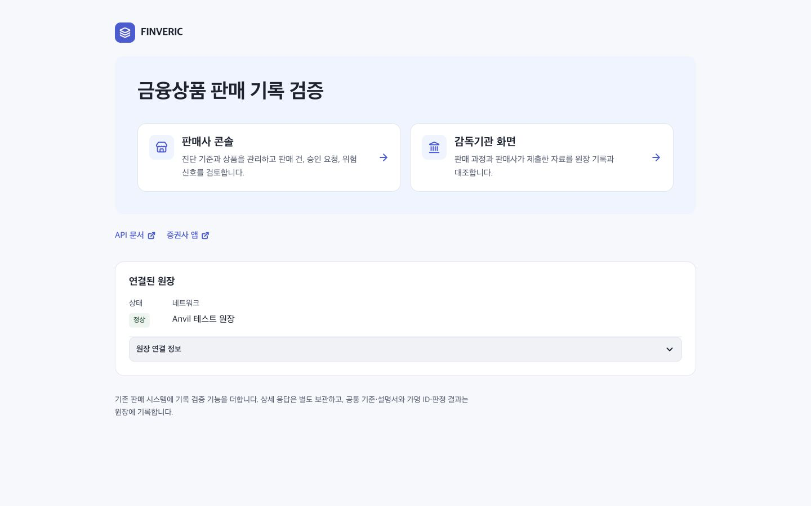
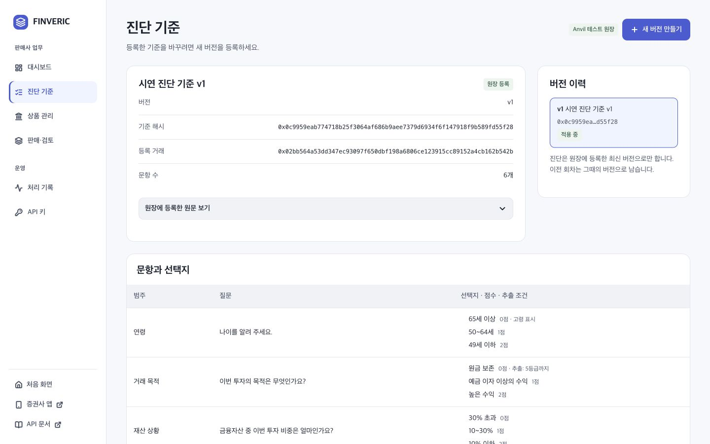
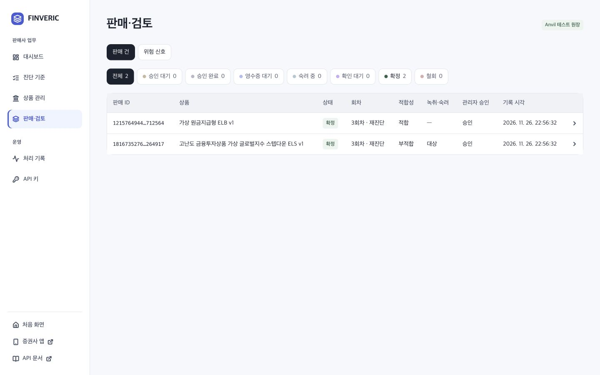
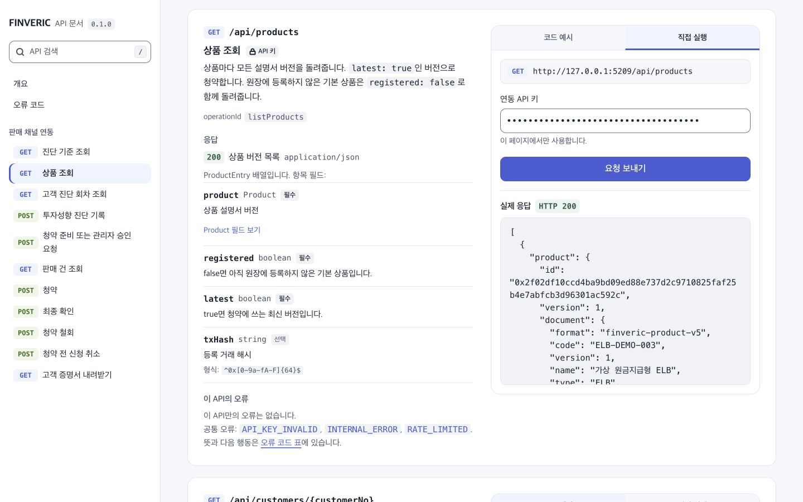
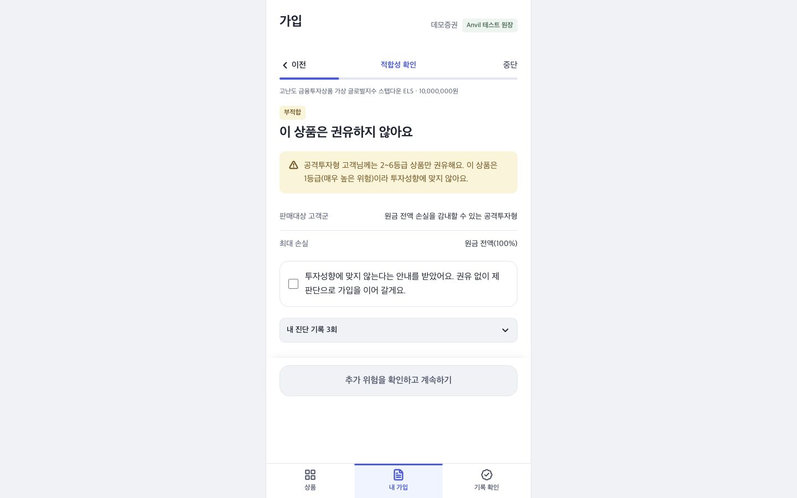
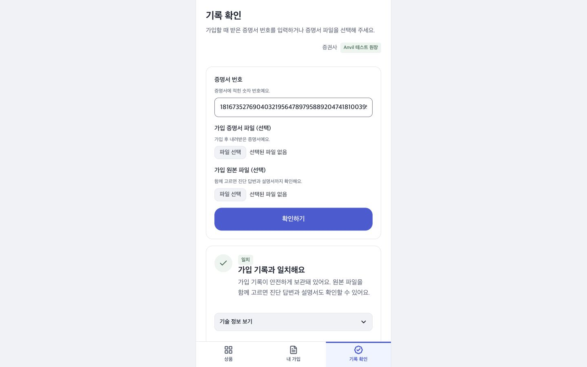
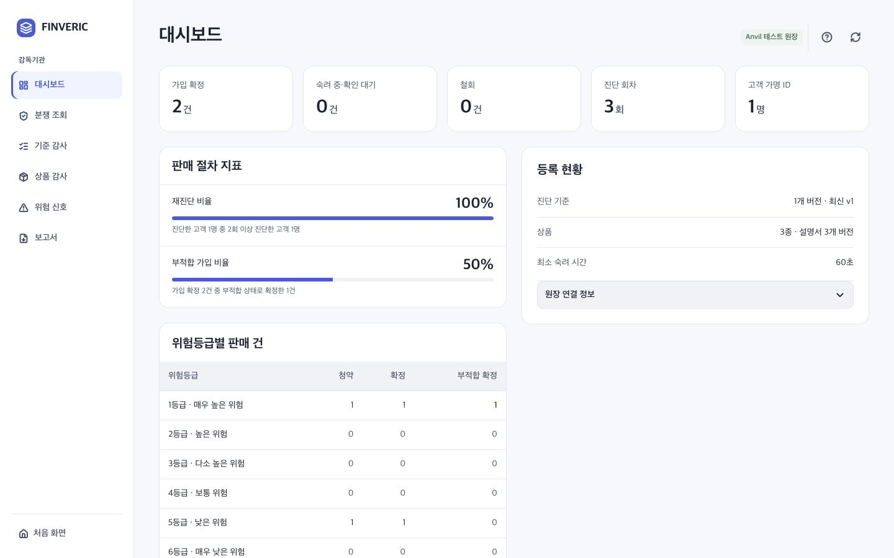
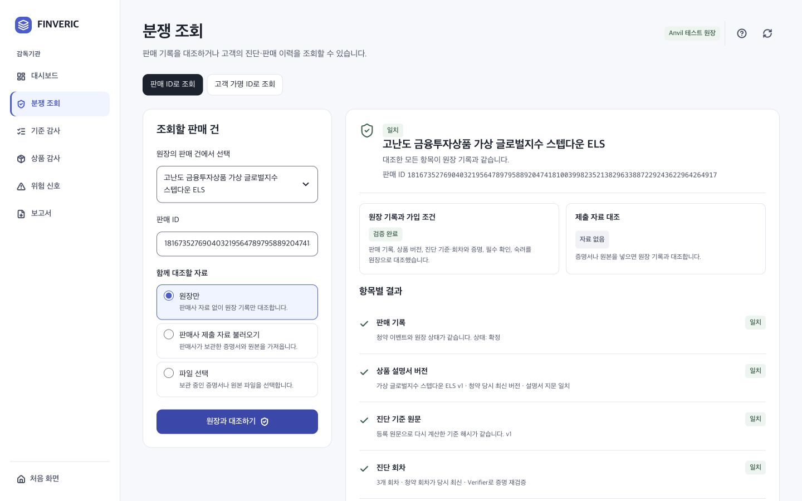

# 핀베릭(FINVERIC), 투자상품 판매 기록 검증 플랫폼

**[가입부터 검증까지 체험하기](https://finveric.vercel.app/channel/)**

접근 코드나 지갑 연결 없이 가상 상품을 선택하고 투자성향 진단, 가입, ZKP 검증을 체험할 수 있다.

[판매사 콘솔 열기](https://finveric.vercel.app/client/) · [감독기관 화면 열기](https://finveric.vercel.app/auditor/)


## 🎬 시연 영상

FINVERIC 통합 시연은 판매사의 진단 기준·상품 설명서 관리부터 증권사 앱의 모바일 가입까지 보여 준다. 감독기관 화면에서 같은 가입 건의 ZKP와 증빙을 원장과 대조한다. 영상은 1분 39초다.

https://github.com/user-attachments/assets/77fd7db5-8fb3-4cfe-a8da-0db06e161c40

## 📌 목차

1. [서비스 소개](#-서비스-소개)
2. [화면](#-화면)
3. [아키텍처](#-아키텍처)
4. [팀원 소개](#-팀원-소개)
5. [기술 스택](#-기술-스택)
6. [실행하기](#-실행하기)
7. [협업 방식](#-협업-방식)
8. [구조와 명령어](#-구조와-명령어)

### 📝 주요 문서

| 구분 | 문서                                                                       | 기여자     |
| ---- | -------------------------------------------------------------------------- | ---------- |
| 기획 | [PRD v5: 제품 정의, 시연 범위, 완료 기준](docs/prd.md)                     | 개발       |
| 기획 | [시장 조사: 경쟁 서비스와 선행 사례](docs/market-research.md)              | 자료조사   |
| 개발 | [결정 기록: 배포, 원장, API 계층, 판매사 콘솔, OpenAPI, API 키](docs/adr/) | 개발       |
| 개발 | [배포: Vercel·Upstash·Sepolia 순서와 환경 변수](docs/deploy.md)            | 개발       |
| 발표 | [실행과 시연: 발표 순서, 검증 절차, 복구](docs/runbook.md)                 | 개발, 발표 |
| 발표 | [QA 체크리스트와 날짜별 기록](docs/qa/README.md)                          | 모두       |
| 팀   | [팀 운영과 자료 정리: 역할, 자료 위치, 넘겨줄 것](docs/team.md)            | 모두       |

---

## 🚀 서비스 소개

판매사(증권사·은행)와 감독기관이 같은 판매 기록을 함께 검증하는 B2B·B2G 서비스다. 기존 판매 관리 시스템에 연결해 기록 검증 기능을 보완한다. 고객별 민감한 원문은 판매사의 기존 보관 체계에서 관리하는 방향이다. MVP에서는 별도의 오프체인 저장소로 이를 재현한다. 투자자는 증권사 앱에서 가입하고, 증권사 앱이 FINVERIC API에 연결한다.

1. **판매 기록과 검증 경로가 분쟁 당사자인 판매사에 몰려 있다**
   - 진단 회차마다, 청약과 최종 확인 때마다 원장에 기록한다. 가입을 중단해도 진단 회차는 남는다.
   - 스마트컨트랙트가 회차 순서, 증명, 추가 위험 확인, 관리자 승인, 녹취, 숙려기간을 검사한다. 기록한 회차는 판매사도 바꿀 수 없다.
2. **답변을 공개하지 않고 판정 결과를 증명한다**
   - ZKP(Groth16)로 원장에 등록한 진단 기준에 따라 투자성향을 계산했음을 증명한다. 진단 기준은 판매사가 버전으로 관리한다.
   - 답변, 총점, 임의값은 원장에 올리지 않는다. 개인정보가 없는 공통 진단 기준·상품 설명서는 원문을 원장에 유지한다. [실제 저장 위치와 ZKP 공개 범위](docs/prd.md#원장-zkp-원본의-역할)를 따른다.
3. **판매사 API 없이 기록을 검증한다**
   - 감독기관은 공개 원장(RPC)만으로 판매 건, 진단 기준·설명서 원문, 위험 신호를 대조한다.
   - 원본을 바꾸면 불일치를 표시한다.

## 🖥 화면

| 페이지   | 경로        | 사용자                       | 화면                                                                                                                       |
| -------- | ----------- | ---------------------------- | -------------------------------------------------------------------------------------------------------------------------- |
| 진입     | `/`         | 모두                         | 역할 선택, 연결된 원장 상태                                                                                                |
| client   | `/client/`  | 판매사 소비자보호 담당 (B2B) | 대시보드, 진단 기준, 상품 관리, 판매·검토, 위험 신호, 온체인 처리, API 키                                                  |
| channel  | `/channel/` | 증권사 앱 예시 (고객 화면)   | 상품, 가입, 내 가입, 기록 확인                                                                                             |
| auditor  | `/auditor/` | 감독기관 (B2G)               | 대시보드, 분쟁 조회, 기준 감사, 상품 감사, 위험 신호, 보고서                                                               |
| API 문서 | `/api/docs` | 판매사 개발자                | 분류별 API, 요청 예시(curl·Node.js·Python), 응답 예시, API별 오류 표, 오류 코드 표. OpenAPI 3.1 원문은 `/api/openapi.json` |

| 진입 화면                                                       | 진단 기준 (client)                                    |
| --------------------------------------------------------------- | ----------------------------------------------------- |
|                      |     |
| **판매·검토 (client)**                                          | **API 문서**                                          |
|              |          |
| **적합성 확인 (증권사 앱 예시)**                                | **기록 확인 (증권사 앱 예시)**                        |
|           |   |
| **대시보드 (auditor)**                                          | **분쟁 조회 (auditor)**                               |
|  |  |

증권사 앱 예시는 판매사 앱이 FINVERIC API로 만들 고객 화면의 예시다. 고객은 FINVERIC 화면을 직접 쓰지 않는다. 판매사 콘솔 사이드바 하단의 **증권사 앱 예시**와 **API 문서**는 새 탭으로 열린다. API 문서는 넓은 화면에서 메뉴, 설명, 요청·응답 예시의 3단으로 보인다. client와 auditor는 서로 링크하지 않는다. 사이드 메뉴의 `FINVERIC`과 **처음 화면**이 진입 화면으로 간다. 캡처는 로컬 Anvil 원장에 시연 데이터(진단 3회, 확정한 ELS·ELB 가입)를 채운 뒤 1440×900으로 찍었다.

## 🏭 아키텍처


<details>
<summary><b>로컬 실행 구성</b> · Vercel → Docker, Upstash Redis → 파일, Sepolia → Anvil</summary>


</details>

- 웹(Vite 앱 하나, 페이지 네 개)과 API를 Vercel 프로젝트 하나, 같은 도메인에 둔다. 상시 서버와 별도 DB 서버는 없다. ([ADR 0002](docs/adr/0002-vercel-functions-and-upstash.md), [ADR 0006](docs/adr/0006-seller-console-and-single-web-app.md))
- API는 등록한 경로로 OpenAPI 3.1 문서를 만든다. ([ADR 0007](docs/adr/0007-openapi-and-channel-sample-app.md))
- API를 부르는 쪽은 둘이다. 소비자보호 담당은 판매사 콘솔을 쓴다. 증권사 앱 서버는 판매사 콘솔에서 발급한 API 키로 `판매 채널 연동` API만 부른다. 서버는 키의 해시만 보관한다. 공개 시연 설정은 [배포 문서](docs/deploy.md#4-환경-변수)에 있다. ([ADR 0008](docs/adr/0008-api-keys.md))
- 오류 응답은 `{ error, type, code }`다. `type`은 분류 16개이고 HTTP 상태를 정한다. `code`는 상황별 코드 52개(`SALE_ALREADY_SUBSCRIBED` 등)다. 코드 목록은 `@finveric/core/errors` 한곳에만 있고, API 문서의 오류 표도 여기서 만든다. 고객 화면은 API 문장을 그대로 보여 주지 않고 `type`으로 고객용 문장을 고른다.
- API가 역할 키(판매사, 승인, 고객, 인프라)로 원장 거래를 보낸다. 단계별 송신자는 [PRD의 판매 절차](docs/prd.md#판매-절차와-원장-기록)를 따른다. MVP는 네 키를 API가 함께 보관한다. 실제 서비스는 허가형 블록체인을 가정한다.
- 원장 v5는 진단 기준과 설명서 원문을 이벤트에 남긴다. ([ADR 0005](docs/adr/0005-ledger-v5-registered-rules.md))

### 가입과 검증 흐름


## 👥 팀원 소개

<div align="center">
<table>
  <tr>
    <th>&lt;이름&gt;</th>
    <th>&lt;이름&gt;</th>
    <th>&lt;이름&gt;</th>
  </tr>
  <tr>
    <th>개발</th>
    <th>자료조사</th>
    <th>발표 자료·영상</th>
  </tr>
  <tr>
    <td>
      - ZKP 회로와 원장 컨트랙트<br>
      - Fastify API와 웹(진입·판매사 콘솔·증권사 앱 예시·감독기관)<br>
      - Vercel·Docker 실행 환경<br>
      - 기술 문서, 그림, 화면 캡처
    </td>
    <td>
      - 경쟁 서비스·제도 조사<br>
      - 선행 사례와 차별화 근거<br>
      - 발표 근거 자료 정리
    </td>
    <td>
      - 발표 PPT와 대본<br>
      - 시연 영상 촬영·편집<br>
      - 발표 흐름 정리
    </td>
  </tr>
</table>
</div>

역할, 자료 위치, 서로 넘겨줄 것은 [팀 운영과 자료 정리](docs/team.md)에 있다.

## 🧰 기술 스택

| 구분         | 기술 스택                                                                                                                                                                                                                                                                                                                                                                                                                                                                                                                                             |
| ------------ | ----------------------------------------------------------------------------------------------------------------------------------------------------------------------------------------------------------------------------------------------------------------------------------------------------------------------------------------------------------------------------------------------------------------------------------------------------------------------------------------------------------------------------------------------------- |
| 프론트엔드   |       |
| 백엔드       |                                                                                                                                                                                       |
| 블록체인·ZKP |                                                                                                                                 |
| 인프라       |                                                                                                                                                                                                                                                                                      |

## 🐳 실행하기

Docker로 실행하는 것을 권장한다. Node, Foundry, Circom을 따로 설치하지 않아도 된다.

### Docker로 실행 (권장)

준비물: Docker Desktop 또는 Docker Engine과 Compose v2. 포트 5173, 3001, 8545가 비어 있어야 한다.

```bash
git clone <저장소 주소> finveric
cd finveric
docker compose up --build -d
```

- 이미지 하나, 컨테이너 하나에서 Anvil, API, 웹을 실행한다.
- 첫 실행은 이미지 빌드(약 3\~4분)와 증명 키 생성·컨트랙트 배포(약 2\~4분)를 거친다. 다음 실행은 볼륨에 남은 키와 원장을 써서 10초 안팎이면 준비된다.
- `docker compose ps`의 상태가 `healthy`가 되면 연다. 이 상태는 health API가 RPC·원장·저장소를 점검한 결과다.
  - [진입 화면](http://localhost:5173/) · [client](http://localhost:5173/client/) · [증권사 앱 예시](http://localhost:5173/channel/) · [auditor](http://localhost:5173/auditor/) · [API 문서](http://localhost:3001/api/docs) · [health](http://localhost:3001/api/health)
- 개발도 Docker로 한다. 소스 폴더를 마운트하므로 웹은 저장하면 바로 반영되고, API는 저장하면 다시 시작한다. 원장·회로나 의존성을 바꿨을 때만 다시 빌드한다. API나 웹 서버가 멈추면 컨테이너가 스스로 다시 시작한다. ([실행과 시연](docs/runbook.md#실행))
- 진행 로그는 `docker compose logs -f`로 본다.
- 멈출 때는 `docker compose down`을 실행한다. 원장 상태와 판매 기록은 볼륨에 남는다. 기록까지 지우려면 `docker compose down -v`를 실행한다.

### Node로 실행

Node.js 22.12 이상 22.x와 npm 10이 필요하다. Foundry와 Circom은 npm 패키지에 들어 있다.

```bash
npm ci
npm run dev
```

- [진입 화면](http://127.0.0.1:5173/) · [client](http://127.0.0.1:5173/client/) · [증권사 앱 예시](http://127.0.0.1:5173/channel/) · [auditor](http://127.0.0.1:5173/auditor/) · [API 문서](http://127.0.0.1:3001/api/docs) · [health](http://127.0.0.1:3001/api/health)
- Docker와 같은 포트를 쓴다. 먼저 `docker compose stop`으로 컨테이너를 멈춘다.
- 로컬 원장 상태와 판매 기록은 `.local/`에 저장한다. 이 폴더를 지우면 이력과 고객 원본을 잃는다.

### 처음 써 보기

1. client의 **상품 관리**에서 **상품·진단 기준 등록**을 누른다.
2. client 사이드바 하단의 **증권사 앱 예시**를 새 탭으로 연다. **상품** 탭에서 상품의 **가입하기**를 누르고 진단부터 청약, 숙려, 최종 확인까지 진행한다. FINVERIC 자체 내부통제 정책에 따라 누적 3회차 이상 진단한 고객의 청약은 client의 **판매·검토**에서 관리자 승인을 한다. 일별 재진단 횟수와는 별개다.
3. **내 가입** 탭에서 판매 건을 열고 **가입 기록 확인하기**를 눌러 고객이 보는 확인 결과를 본다.
4. **처음 화면**으로 돌아가 감독기관 화면을 연다. **분쟁 조회**에서 같은 판매 건을 원장과 대조한다.
5. client의 **API 키**에서 키를 발급한다. **API 문서**의 요청 예시에 그 키를 넣어 `판매 채널 연동` API를 불러 본다.

발표 순서와 시연 수치는 [실행과 시연](docs/runbook.md)을 따른다.

## 🤝 협업 방식

### 역할 분담

- **개발(1명).** 회로, 원장, API, 웹, 배포, 기술 문서, 그림과 화면 캡처를 맡는다.
- **자료조사·발표 자료·영상(2명).** 조사 결과는 [시장 조사](docs/market-research.md)에 반영한다. 발표 자료의 위치는 [팀 운영](docs/team.md)의 자료 표에 적는다.
- 팀원은 Docker로 각자 시연 환경을 띄운다. 그림과 캡처는 `docs/assets/`에서 가져다 쓴다.

### 개발

- 시연 전에는 [QA 체크리스트](docs/qa/README.md#체크리스트)로 화면을 점검하고 [날짜별 기록](docs/qa/README.md#날짜별-기록)에 결과를 남긴다.
- `main` 브랜치에 커밋하고 push한다. 검사는 로컬에서 `npm run contracts:test`, `npm test`, `npm run build`로 돌린다. GitHub Actions 검사(증명 키 생성, 원장 검사, 통합 검사, 빌드)는 지금 자동으로 돌리지 않는다. 필요하면 Actions 탭에서 수동으로 실행한다.
- 되돌리기 어렵고, 맥락 없이는 의아하고, 대안 중에 고른 결정만 [결정 기록(ADR)](docs/adr/)으로 남긴다. 기준은 [docs/AGENTS.md](docs/AGENTS.md#adr)에 있다.
- 영역별 작업 규칙은 각 폴더의 `AGENTS.md`에 있다.

### 실제 처리와 모의 처리

- 실제: ZKP 생성·검증, 원장 거래, 영수증·이벤트 조회, 원본 대조
- 모의: 본인인증, 전자서명, 녹취, 자금 이동, 결제·발행 결과
- 증명 키는 단일 운영자가 만든 시연용 trusted setup이다. 운영에 쓰지 않는다.
- 감독기관의 공식 참여와 실제 판매 시스템 연동은 설계 가정이다.

## 📂 구조와 명령어

```
apps/
  web/         웹. 진입 화면(/), client(/client/), channel(/channel/), auditor(/auditor/)
    src/shared/  페이지들이 함께 쓰는 화면 요소, 스타일(theme.css), API 클라이언트
  api/         Fastify API (routes · modules · repositories · gateways), API 문서(/api/docs)
packages/
  core/        @finveric/core. 판정·해시·검증 로직, 원장 ABI, API 계약(DTO), 오류 코드.
               API·웹·스크립트·테스트가 함께 쓴다. 빌드하지 않고 원본 .ts를 쓴다
circuits/      ZKP 회로
contracts/     원장 컨트랙트
deploy/        Vercel 빌드에 쓰는 원장 배포본
scripts/       개발·배포·시연 스크립트
tests/         통합 검사
docs/          문서, 그림(assets/)
```

API 안의 계층(경로 → 업무 절차 → 리포지토리·게이트웨이)은 [ADR 0004](docs/adr/0004-api-layers.md)를 따른다.

| 명령                                                             | 내용                                                                                                |
| ---------------------------------------------------------------- | --------------------------------------------------------------------------------------------------- |
| `docker compose up --build -d`                                   | Docker로 Anvil, API, 웹을 실행한다                                                                  |
| `npm run dev`                                                    | Node로 Anvil, API, 웹을 실행한다                                                                    |
| `npm test`                                                       | 실제 회로·EVM·API 통합 검사, API 문서·오류 코드·API 키 검사, 저장소·잠금 검사                       |
| `npm run contracts:test`                                         | 원장의 단계·권한 검사 (Foundry)                                                                     |
| `npm run build`                                                  | 타입 검사와 웹 빌드                                                                                 |
| `npm run demo -- --api <API 주소> --rpc <RPC 주소>`              | 시연 데이터를 API로 채운다(진단 3회, 관리자 승인, 확정한 가입 2건). 결과는 `.local/demo/v5/`에 둔다 |
| `npm run sepolia:prepare` → `deploy:sepolia` → `release:sepolia` | Sepolia 원장 배포 ([배포](docs/deploy.md))                                                          |
| `npm run build:vercel`                                           | Vercel 결과물(`.vercel/output`)을 만든다                                                            |

화면 규칙과 디자인 토큰은 [DESIGN.md](DESIGN.md), 작업 규칙은 [AGENTS.md](AGENTS.md)에 있다.
